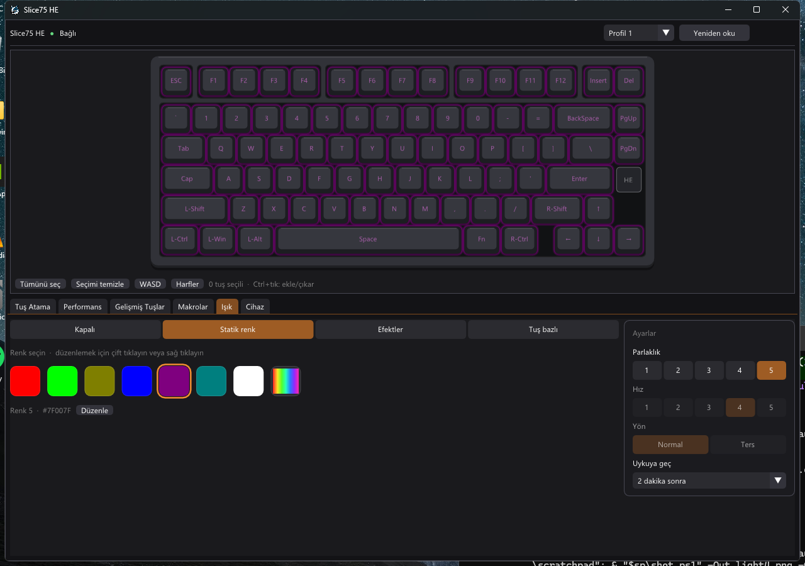
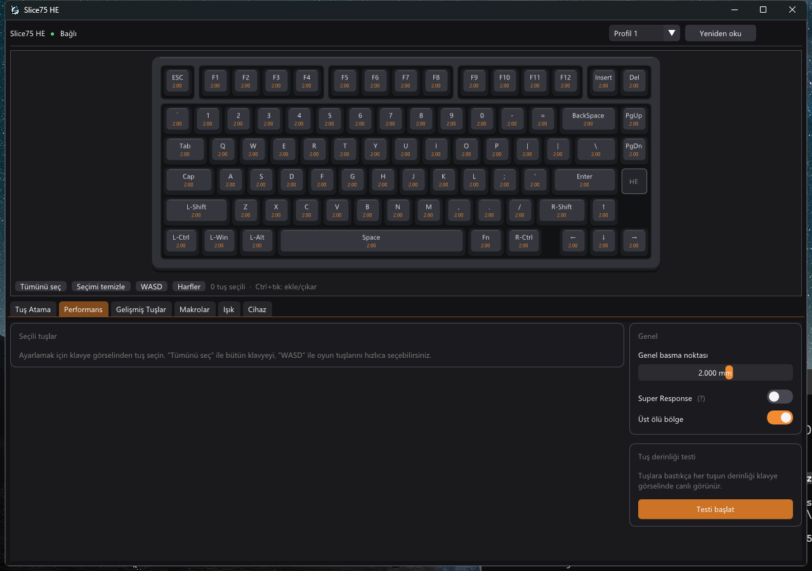

# Slice75 HE Native

Chilkey Slice75 HE manyetik (Hall effect) klavye için **resmi olmayan**, hafif bir Windows yapılandırma
programı. Üreticinin tarayıcı tabanlı sürücü sayfasının yerine, Chrome açmadan çalışan tek bir `.exe`.

> Bu proje Chilkey ile bağlantılı değildir ve onlar tarafından desteklenmez. Kendi sorumluluğunuzda kullanın.



## Neden?

| | Tarayıcıda sürücü sayfası | Slice75 HE Native |
|---|---|---|
| RAM | birkaç yüz MB (Chrome) | ~50 MB |
| Boştayken CPU | – | ~%0 (yalnızca değişiklik olunca çizer) |
| Kurulum | Chrome/Edge + internet | tek `.exe`, internet gerekmez |

C++, Win32, Direct3D 11 ve [Dear ImGui](https://github.com/ocornut/imgui) ile yazıldı. Klavyeyle doğrudan
Windows HID API üzerinden konuşur.

## Özellikler

- **Tuş atama**: 4 katman (Fn0–Fn3); harf, sembol, medya, fare ve sistem tuşları
- **Performans**: genel ya da tuş bazlı basma noktası, Rapid Trigger, ölü bölgeler, switch tipi,
  Super Response, üst ölü bölge, canlı tuş derinliği testi
- **Gelişmiş tuşlar**: DKS, MPT, Mod-Tap, Toggle, END, RS, SOCD (Snap Tap)
- **Makrolar**: klavyeden kayıt veya elle düzenleme, 4 çalışma modu
- **Işık**: statik renkler, 20 efekt, tuş bazlı renk (ör. sadece WASD farklı), parlaklık, hız, uyku
- **Cihaz**: polling rate (8 kHz'e kadar), Windows/macOS modu, 4 profil, kalibrasyon, fabrika ayarı

Firmware güncellemesi ve ekran görseli yükleme **yoktur**; bunlar için üreticinin sayfasını kullanın.



## Kullanım

1. [Releases](../../releases) sayfasından `Slice75HE.exe`'yi indirin ve çalıştırın.
2. Klavyeyi USB kablosuyla bağlayın; program otomatik bulur.
3. Tarayıcıda üreticinin sürücü sayfası açıksa kapatın; aynı anda yalnızca bir program klavyeyle konuşmalı.

Makrolar klavyeden geri okunamadığı için `%APPDATA%\Slice75HE\macros.txt` dosyasında saklanır.

## Derleme

Gereken: Windows 10/11, Visual Studio 2022 Build Tools (C++ iş yükü).

```powershell
.\build.ps1          # bin\Slice75HE.exe
.\build.ps1 -Debug
```

Dear ImGui ilk derlemede otomatik indirilir.

## Durum

Test edilen cihaz: Slice75 HE, firmware App V1.1.7, protokol 1.0.7.

Bağlanma, ayarları okuma ve ışık ayarları gerçek klavyede doğrulandı. Diğer ayarlar protokol notlarına göre
yazıldı ama henüz donanımda tek tek denenmedi. Ayrıntılar ve doğrulanmamış noktalar için
[docs/PROTOCOL.md](docs/PROTOCOL.md) dosyasına bakın. Hata bulursanız issue açın.

## English

Unofficial lightweight native Windows configurator for the Chilkey Slice75 HE Hall-effect keyboard: keymap
(4 layers), actuation / Rapid Trigger / deadzones, advanced keys (DKS, MPT, MT, TGL, END, RS, SOCD), macros,
RGB lighting (including per-key colours), polling rate, profiles and calibration. Single `.exe`, about 50 MB of
RAM, built with C++ / Direct3D 11 / Dear ImGui. Not affiliated with Chilkey. The UI is in Turkish. The protocol
notes are in [docs/PROTOCOL.md](docs/PROTOCOL.md).

## Lisans

[MIT](LICENSE). Dear ImGui kendi MIT lisansıyla dağıtılır.
